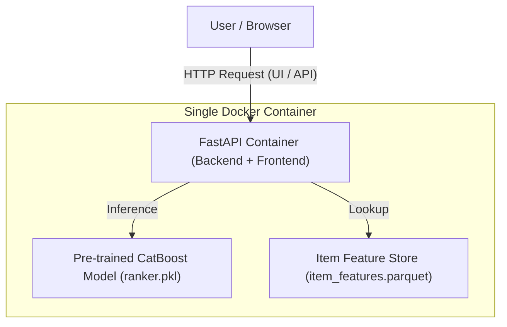

# E-Commerce Recommendation System (ML Zoomcamp Capstone Project)

[](https://www.python.org/)
[](https://fastapi.tiangolo.com)
[](https://catboost.ai/)
[](https://www.docker.com/)
[](https://cloud.yandex.com/)

End-to-end Machine Learning web application that predicts purchase likelihood for e-commerce items based on behavioral logs, event categories, time features, and item metadata from the Retailrocket dataset.

The application integrates a **FastAPI backend and frontend interface into a single container** and runs in Yandex Cloud Serverless Containers provisioned via Terraform and deployed via GitHub Actions.

Built as a capstone project for the **[DataTalks.Club Machine Learning Zoomcamp](https://github.com/DataTalksClub/machine-learning-zoomcamp)**.

---

## Problem Description

E-commerce platforms continuously process millions of user events (views, add-to-carts, purchases), but identifying which items a user is most likely to purchase remains a critical challenge for conversion optimization and targeted recommendations. 

**The Solution:**
This project provides an automated machine learning prediction service designed to score items and predict purchase probabilities:
1. **Purchase Likelihood Prediction**: Calculates the probability that a user or session will convert on a given item based on rich interaction metrics and contextual features.
2. **Automated Feature Engineering & Processing**: Cleans raw Retailrocket interaction logs, aggregates item-level metrics (`views`, `purchases`, `ctr`), and builds a lightweight feature store (`item_features.parquet`).
3. **High-Performance Ranking**: Trains robust gradient boosting models using **CatBoost** to rank items and predict binary purchase targets.
4. **Production Web Service**: Serves predictions through an intuitive web interface and REST API powered directly by **FastAPI**.
5. **Cloud Deployment**: Fully containerized and deployed to **Yandex Cloud Serverless Containers** using Infrastructure as Code (Terraform) and automated CI/CD workflows.

---

## System Architecture



## Tech Stack & Tools

- **Machine Learning**: CatBoost, Scikit-Learn, Pandas, NumPy, DVC.
- **Backend & Frontend**: FastAPI, Uvicorn, HTML/CSS (Single-page interface).
- **Containerization**: Docker (optimized single-container build bundling backend, UI, model, and feature store).
- **Infrastructure as Code**: Terraform (Yandex Cloud Serverless Containers & Container Registry).
- **CI/CD & Deployment**: GitHub Actions (`workflow_dispatch` manual trigger).

---

## Repository Structure

```
.
├── data/
│   └── item_features.parquet       # Lightweight aggregated item feature store for inference
├── frontend/
│   ├── default.conf                # Nginx custom configuration
│   └── index.html                  # Built-in web UI for purchase predictions
├── notebooks/
│   └── EDA.ipynb                   # Jupyter notebook for exploratory data analysis and baseline modeling
├── scripts/
│   ├── loaded_models.py            # Model & feature store loader utilities
│   ├── main.py                     # FastAPI application & serverless entrypoint
│   ├── prepare_features.py         # ETL & feature engineering pipeline script
│   └── train_model.py              # CatBoost model training and validation script
├── tf/                             # Terraform infrastructure code for Yandex Cloud
├── .github/workflows/              # GitHub Actions deployment pipelines
├── Dockerfile                      # Optimized production container build recipe
├── pyproject.toml                  # Project metadata & dependency configurations
├── requirements.txt                # Python package requirements (used in Dockerfile only)
└── ranker.pkl                      # Pre-trained CatBoost ranking model artifact
```

---

## Exploratory Data Analysis & Model Training (Jupyter Notebook)

The exploratory data analysis, data cleaning pipelines, feature engineering, and initial model benchmarking are fully documented in the interactive Jupyter notebook located at `notebooks/EDA.ipynb`.

**Key steps performed in the notebook:**
1. **Exploratory Data Analysis (EDA)**: Examining the distribution of user interactions across views, add-to-carts, and purchases in the Retailrocket dataset, identifying data sparsity and class imbalance.
2. **Data Cleaning & Aggregation**: Processing raw event logs, handling timestamps, mapping categories, and filtering out invalid entries.
3. **Feature Engineering**: Computing interaction counts per item (`views`, `purchases`, click-through rates), extracting temporal components (`hour`, `weekday`), and building structured feature matrices.
4. **Model Training & Evaluation**: Training **CatBoost** classifiers, evaluating performance using ranking and classification metrics (**PR-AUC** of 0.1402 and **ROC-AUC** of 0.9192), and serializing the model artifact (`ranker.pkl`).

---

## Quickstart & Setup Guide

### Prerequisites
- Python 3.12 & `uv` or `pip`
- Docker installed locally
- Yandex Cloud account (for cloud deployment via Terraform/GHA)

---

### Option A: Local Run in Docker

#### 1. **Clone the repository and navigate to the project directory:**
   ```bash
   git clone https://github.com/petr-akimov/ecom-capstone-ml2026
   cd ecom-capstone-ml2026

#### 2. **Build the Docker image:**

```
docker build -t ecom-recommendation:latest .
```

#### 3. **Run the container locally:**

```
docker run --rm -p 8080:8080 --name ecom-test ecom-recommendation:latest
```

#### 4. **Access the service:**

- Open your browser and go to http://localhost:8080 to use the interactive web interface.
- Test the prediction API directly via curl:
```
curl "http://localhost:8080/predict_purchase?itemid=98113&hour=14&weekday=3"
```

### Option B: Deployment to Yandex Cloud Serverless Containers

The project includes automated infrastructure provisioning via **Terraform** and deployment via **GitHub Actions** (triggered manually via `workflow_dispatch`).

#### 1. Configure GitHub Secrets
In your GitHub repository go to **Settings -> Secrets and variables -> Actions** and add:
* `YC_TOKEN` — Yandex Cloud OAuth or IAM token.
* `YC_CLOUD_ID` — Your Yandex Cloud ID.
* `YC_FOLDER_ID` — Your Yandex Cloud Folder ID.

#### 2. Infrastructure Setup & Deployment via GitHub Actions
1. Navigate to the **Actions** tab in your GitHub repository.
2. Select the **Deploy E-Commerce Predictor to Yandex Serverless Containers** workflow.
3. Click **Run workflow** (manual trigger).
4. The workflow will:
   * Initialize Terraform and provision the Container Registry and Service Account permissions (`tf/`).
   * Build the optimized Docker image and push it to Yandex Container Registry.
   * Deploy the service to **Yandex Serverless Containers** with public access enabled.
   * Output the public URL of your live application.

---

## API Endpoints

* **`GET /`** — Interactive Web UI (HTML).
* **`GET /health`** — Service health check & model status.
* **`GET /predict_purchase?itemid=...&hour=...&weekday=...`** — Returns the purchase probability and recommendation status for a specific item.

---

## Evaluation Criteria Compliance Matrix

| Criteria | Points Claimed | Supporting Artifacts & Implementation Details |
| :--- | :---: | :--- |
| **Problem Description** | **2 / 2** | [README.md](README.md): Outlines the business objective of predicting purchase conversion for e-commerce items using behavioral logs. |
| **EDA & Data Prep** | **2 / 2** | [notebooks/EDA.ipynb](notebooks/EDA.ipynb) & [scripts/prepare_features.py](scripts/prepare_features.py): Detailed analysis of user event logs, feature extraction, and feature store creation. |
| **Model Training & Tuning** | **3 / 3** | [scripts/train_model.py](scripts/train_model.py): Training robust gradient boosting models (**CatBoost**) evaluated with ROC-AUC and PR-AUC. |
| **Script Conversion** | **1 / 1** | [scripts/prepare_features.py](scripts/prepare_features.py) & [scripts/train_model.py](scripts/train_model.py): Clean extraction of preprocessing and training logic into reproducible scripts. |
| **Reproducibility** | **2 / 2** | [pyproject.toml](pyproject.toml) and structured directories with clear step-by-step execution instructions. |
| **Model Deployment** | **2 / 2** | [scripts/main.py](scripts/main.py): Functional FastAPI web service with prediction endpoints and embedded UI. |
| **Dependency Management** | **2 / 2** | [pyproject.toml](pyproject.toml) & [uv.lock](uv.lock): Locked/pinned dependencies using the `uv` package manager. |
| **Containerization** | **2 / 2** | [Dockerfile](Dockerfile): Production-ready single-container build bundling FastAPI, frontend UI, model artifact, and feature store. |
| **Cloud Deployment** | **2 / 2** | [tf/](tf/) & [.github/workflows/](.github/workflows/): Terraform infrastructure and manual GHA workflow for Yandex Serverless Containers. |

## Local Development & Training (Optional)

If you want to re-run the pipeline locally:
```bash
uv venv .venv
source .venv/bin/activate
uv sync
```

# Run feature engineering (requires raw CSVs in data/)

```
python prepare_features.py --events events.csv --item-props item_properties_part1.csv --out-item-feats item_features.parquet --out-train data_for_training.parquet
```


# Train the model
```
python scripts/train_model.py
```
# Run FastAPI locally

```
python -m scripts.main
```
